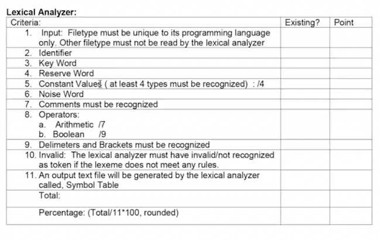
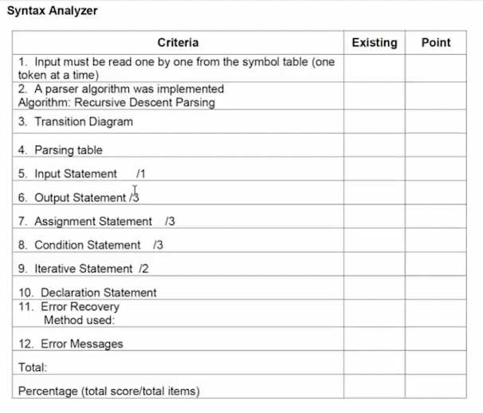

# Programming Language Meeting — 5 November 2026

**Meeting date:** 5 November 2026 (Asia/Manila)

**Start here:** [Four-page team guide](../../LAlgo_Team_Requirements_Guide.pdf) with green Ready / red Focus status and short timestamped quotes. [Editable LaTeX](../../lalgo_team_guide.tex).

**Recordings, in order:** `1.mp4` (approximately 5:57), `2.mp3` (approximately 1:44), then `3.mp3` (approximately 1:09), then `4.mp3` (approximately 8:11). The syntax-analyzer screenshot in Section 4.3 was displayed during recording 04, according to Adriel.

**Sequence:** All recordings for this meeting are collected in this single document, in the order supplied. Timestamps restart for each recording; the gap between recordings is unknown. Append future recordings here in sequence.

The chronological transcripts come first in the original Tagalog/English, followed by a unified English digest, schedule, comparison with LAlgo, illustrative examples, and team checklist. Sections 2.5 and 2.11 record instructions initially supplied by Adriel without timestamps; recording 04 later confirms and clarifies Section 2.5. Explanations and suggested tasks are editorial notes, not additional instructions from Ma'am.

**Transcript status:** Machine-assisted, lightly edited for punctuation and technical spellings; checked against a second speech-recognition pass, not independently verified by human listening. This is a readable transcript, not a certified verbatim record. `[unclear]` identifies wording that could not be recovered confidently. Speaker labels are inferred from the exchange; timestamps are approximate. Pauses and repeated fillers are shortened.

## 1. Chronological transcripts

### 1.1 Recording 01 — Introduction, deadlines, and syntax-analyzer requirements

#### 00:00–00:32 — Faculty workload and accreditation

**Ma'am:** “Since this week is [unclear opening phrase about the week's work schedule]. Pero itong week na 'to, according to the schedule of CCIS, [unclear acronym/phrase], lahat kami halos [unclear phrase about the faculty], for the accreditation that will be happening sa college natin.

“So I have only this week and this week to do this. Under ako ng research eh, tsaka internationalization. So, medyo busy ang mga lola n'yo pagdating dito.”

#### 00:32–00:55 — Continue individual work and the lexical analyzer

**Ma'am:** “So I suggest dito na lang, at kung ano man 'yung individual work na pagagawa ko sa inyo, pagagawa ko dito. At the same time, gawin n'yo na rin 'yung inyong lexical analyzer.

“As I have mentioned last time, dapat nung Tuesday, ginawa n'yo na 'yung ibang ginagawa for this one.”

#### 00:55–01:40 — November 12 submission and documentation Part 3

**Ma'am:** “Ayan, alam ko na. For November 12, I would like for you to submit the syntax grammar rule, or the proposal for the syntax rule for your programming language.

“So 'yung inyong documentation, malalagyan ng Part 3. 'Di ba? Ang Part 1 ng documentation n'yo is Introduction. Part 2 is the syntactic elements. Tama? Part 3 will be the syntax rule of your programming language.

“You have to define the set of terminals, non-terminal symbols, the production and the start symbols. Also, you need to do your grammar rules. Okay?”

> Transcription note: Both main recognition passes render the Part 2 phrase as “syntactic elements.” Our existing specification calls its second section **Lexical Elements**. Preserve that distinction for now; this recording alone does not establish a required rename.

#### 01:40–02:22 — Face-to-face default; derivations for every syntax rule

**Ma'am:** “So in every grammar rules, okay, so basta 'yan muna. Sa 12 'yan [unclear short phrase]. Pakitake note 'to ha, 12, 'yun ang isasubmit. At the same time, kung ano man 'yung gusto ko ipagawa sa inyo dito during this time.

“I'm not saying this is online. This can be face-to-face. Okay? By default, face-to-face tayo sa 12. So submission of the syntax rules with derivations for every syntax rule.

“Okay? With derivation ha. Ang derivation ay parse tree, leftmost and rightmost. Bahala kayo kung top-down or bottom-up 'yung gagamitin n'yo.”

#### 02:22–03:18 — Remaining checking schedule and final exam

**Ma'am:** “19, async tayo. 26, checking of lexical analyzer 2 and syntax 1.

“For December, this week ay ano tayo? Vacant. I mean, asynchronous tayo. You do the project because on the 10th, [we/you — unclear pronoun] will be checking the syntax 2 and semantic 1, which is the final checking of your project and the final exam. Maliwanag po?

“Kasi ang departmental exam ng CCIS is scheduled on 15, 16, 17. So uunahan ko siya ng 10. Hanggang 22 lang ang first semester natin, so we don't have any chance. Kailangan dito natin ma-check na 'to. Kaya sabi ko kailangan ko na talagang iklase na rin 'yung dalawang topics. Na-gets ba? Malinaw?”

#### 03:18–04:03 — Student repeats the dates for clarification

**Student:** “Ma'am, clarify ko lang po.”

**Ma'am:** “Yes, [student's name].”

**Student:** “If tama po ba 'yung nalagay ko. November 12 po is pagpasa po ng proposal for syntax grammar.”

**Ma'am:** “Oo, 'yung parang documentation n'yo.”

**Student:** “November 19 po is asynchronous. November 26 po is lexical checking 2 and syntax 1. Then December 3 is asynchronous po. Then December 10 po is syntax 2 and semantics 1. [Unclear short closing phrase.] Thank you po.”

**Ma'am:** “Kasi December 22, tapos na tayo ng first semester, according to our university calendar. Okay? Na-gets na? Okay na? Sige.”

#### 04:03–04:22 — Fix the previously identified lexer issues

**Ma'am:** “Kung ano man 'yung sinasabi ko sa inyong dapat n'yong gawin doon sa lexical analyzer n'yo, the last time we checked, kailangan maayos na 'yun pag nag-check ako next meeting or next checking. Nagkakaintindihan ba tayo?”

#### 04:22–04:54 — Syntax analyzer input and derivation output

**Ma'am:** “Ngayon, sa syntax analyzer, ano ang requirement ko? Well, the syntax analyzer, kailangan magre-read siya from the symbol table, one token at a time, to check for the construct or to check for the syntax.

“Ang magiging output n'yo would be a parse tree. ‘Ma'am, paano ang parse tree?’ Actually, hindi naman tree. Parang ano lang, may arrow lang na gano'n para makita na nade-derive n'yo. In every rule, nakaka-derive kayo. Sa bawat rule, may derivation na nangyayari.”

> Speaker note: The “Ma'am, paano…” phrase appears to be Ma'am anticipating a question; it is not confidently identifiable as a separate student's turn.

#### 04:54–05:22 — Syntax errors, panic mode, and a later demonstration

**Ma'am:** “Pag tama sila, makikita ko lang 'yung parse tree. Pag may error siya, sasabihin ‘syntax error, [likely: at line …]’. At meron akong nakasulat doon na mode of… mode of… parang error generation. Merong panic mode kang gagawin.

“Okay? Papakita ko sa inyo mamaya kung paano natin naman i-check ang syntax analyzer after the discussion that we're going to have.”

> Transcription note: The exact error-message wording and the phrase before “panic mode” are uncertain. “Panic mode” is clear in both main passes. The promised demonstration is outside this introduction.

#### 05:22–05:57 — One example per rule; leftmost and rightmost derivations

**Ma'am:** “Okay, hanggang doon lang tayo. Sa documentation naman, ganito. Kasi may required ako ng statements. For every statement, may required ako kung ano 'yun.

“So for every example of that rule—for every rule, magkakaroon kayo ng isang example lang. And that example should be derived using your grammar rule. And the derivation will be leftmost and rightmost, parse tree. Bahala kayo kung ito ay bottom-up or top-down. Na-gets?”

### 1.2 Recording 02 — Conditional statements and one example per rule

#### 00:00–00:22 — Three required IF forms

**Ma'am:** “In your programming language, ang required ko lang ay IF statements. Pero tatlo, nabanggit ko na 'yan sa inyo. Tatlo. Ano 'yung tatlo na 'yun? 'Yung single IF, 'yung IF–ELSE, at saka 'yung nested IF, ELSE IF, ELSE IF, ELSE. Right?”

#### 00:22–00:42 — Three rules and three examples

**Ma'am:** “So in your IF statement sa inyong programming language design, kailangan meron kayong tatlong rules for that. Sa single IF, sa IF–ELSE, at saka IF–ELSE IF. So dapat meron kayong tatlong examples. Naintindihan?”

#### 00:42–01:08 — Give an example for every rule

**Ma'am:** “If you have more than rules—more than three rules in your IF statements—well, I need to have one example for every statement. Kasi napansin ko sa mga students minsan, one example for IF statement. Eh, mali. One example for every rule in that statement.”

> Wording note: The first sentence contains a spoken restart. The following sentences explicitly clarify the requirement as **one example per rule**.

#### 01:08–01:34 — Different examples must cover different rules

**Ma'am:** “If you have three rules, then I have three different examples based on each rule. Gets? Meron kasi ang nangyayari, three examples nga, pero isang rule lang naman ang ginagawa. No. If you have three rules, I have three different statements for that rule. Each rule should have one example. Gets?”

#### 01:34–01:44 — Derive the examples using your own syntax

**Ma'am:** “Okay? Tapos ide-derive n'yo 'yan using the syntax that you have developed or constructed.”

### 1.3 Recording 03 — Define sequence control and compare language operations

#### 00:00–00:13 — Identify and design the language's sequence control

**Ma'am:** “But I would like for you to identify in your PL the sequence control that you will be using. When I say identify, 'yun na 'yun, magde-design na kayo.”

#### 00:13–00:27 — Define conditional and iterative statements in the proposal

**Ma'am:** “Ilan ba ang aking condition statements? Paano ba 'yung itsura ng aking iterative statement? And you have to define them in the document. When I say define, that is included in your proposal. Gets?”

#### 00:27–00:44 — Earlier exercises, expressions, and notation

**Ma'am:** “[Unclear reference to an exercise] … formula of A, B plus C times D over C. Ginawa n'yo 'yan saan? Ginawa n'yo na 'yan sa data structure, ginawa n'yo pa 'yan sa iba. And then the discussion of infix and prefix.”

> Transcription note: The exercise reference and the exact expression around 00:27–00:35 are not confidently recoverable. The two recognition passes differ on the exercise wording. The spoken symbols are retained without inventing an equation, assignment, or grouping. This excerpt does not establish a new numbered exercise or its submission requirement.

#### 00:44–00:59 — Compare C and Java to inform the PL design

**Ma'am:** “But I would like for you to be able to compare the different operations in C and Java para lang magkaroon kayo ng idea. Paano ba ito? Or paano 'yung gagawin n'yo sa programming language n'yo?”

#### 00:59–01:09 — Python is an optional comparison reference

**Ma'am:** “If you like to use Python, then go on. Then mag-Python, pati 'yung Python, compare n'yo lang. Just for you to understand what it is. Okay?”

### 1.4 Recording 04 — Syntax-analyzer checking guide and detailed requirements

#### 00:00–00:15 — The guide will be used for checking

**Ma'am:** “And this will be used for our syntax analyzer. Okay, so I will be discussing one at a time, what will be this one, para habang gumagawa kayo ng inyong project, alam n'yo kung ano 'yung iche-check natin dito.”

#### 00:15–00:50 — Read one token at a time and check the statement

**Ma'am:** “For criteria number one, input must be read one by one from the symbol table. If you remember the diagram that I have shown you, sabi, from the symbol table, a token will be given to the syntax analyzer one at a time until it reaches a terminator for a particular statement. And then it will then be parsed to know if that particular statement is correctly constructed or not. Tama?”

#### 00:50–01:32 — In-memory input and grammar terminals are allowed

**Ma'am:** “So sa lexical analyzer n'yo, na ang output ay symbol table, pinapayagan ko na kayo na aside from the symbol table, ipapasok n'yo na lang siya sa memory. And then 'yung mga token n'yo, instead na keyword ang IF, puwede nang IF, kasi 'yun 'yung hahanapin nung inyong syntax. Na-gets n'yo? Okay?

“So the one to be passed from the symbol table can either be token or a lexeme already, one at a time. Basta siya ay terminal symbols. Puwede na. Puwede rin naman kasi may rules kayo.”

#### 01:32–02:13 — Implement a parser; recursive descent is an example

**Ma'am:** “Then, a parser algorithm was implemented. And then nilagay ko dito, algorithm: recursive descent parsing. This is the commonly used algorithm. Recursive descent parsing is just an example of algorithm that can be used for parser algorithm.

“If you're going to read [name sounds like Sebesta]'s book, there are lots. If you read Compiler Design by Ullman and Hopcroft, there are lots. But I am not going to demand na 'yun 'yung gamitin n'yo. A simple recursive descent parsing is okay with me. But then again, as I have mentioned, depende ang inyong grades sa magiging gusto n'yong gawing algorithm dito.”

> Transcription note: The textbook references are retained as spoken; the first author's spelling is uncertain. No specific title/edition or numerical grading rule is established by this passage.

#### 02:13–03:05 — Transition diagram and parsing table are optional

**Ma'am:** “Ano naman 'yung transition diagram? Actually, this one is just like a pushdown automata, paano ka magke-create ng language checking. So since ang automata n'yo wala pa nito, hindi ko muna ito ire-require sa inyo. Okay?

“'Yung parsing table, number four, is actually sometimes being used by a bottom-up parser. So kung top-down ka, hindi na kailangan 'to. Yes? Pero itong five hanggang twelve, importanteng meron ito. Yes? So 'yung three and four, optional 'yan. Maliwanag?”

#### 03:05–03:16 — One input statement

**Ma'am:** “Pero 'yung five, kailangan meron kang input statement, isa. Bahala ka kung ilang rules meron 'yun, basta meron kang isang input statement.”

#### 03:16–03:57 — Three output forms

**Ma'am:** “Meron kang output statement. Tatlong rules ang meron ka. Ano 'yun? 'Di ba puwede kang mag-output nung string lang, ‘Hello world’? 'Di ba? Puwede kang mag-output ng value nung variable, printf, percent d, comma i. 'Di ba? Puwede?

“At puwede ka rin mag-output nung dalawa, may string at may value ng variable. ‘Your age is %d’, i. Tama ba? That is the three examples of output statement.”

> Notation note: The printf and format-string references are spoken examples, not prescribed LAlgo syntax. Punctuation/quoting around those examples is editorial.

#### 03:57–04:36 — Assignment differs from declaration with initialization

**Ma'am:** “How about assignment statement? Meron ka rin puwedeng tatlo na nire-require ko na meron kayo. Ano-ano 'yun? Assignment of one variable to another variable.

“Assignment statement is different from declaration with assignment. This is just plain assignment statement. `a = b + 3` is an assignment statement. You don't say `int a = b + 3` as an assignment statement because that is a declaration statement with assignment. Yes? So iba 'yung assignment lang talaga.”

#### 04:36–05:11 — Three assignment forms

**Ma'am:** “So assignment of the value of a variable to another variable, like `a = b`. Then assignment of a constant value to a variable, like a is equal to hello, or `a = 1`. Tama ba? Then assignment of the expression's value to a variable. A is equal to three plus two times five divided by five plus three. Tama ba? So those are the examples of an assignment statement.”

> Notation note: The spoken expression is `a = 3 + 2 * 5 / 5 + 3`; no extra grouping is added. “Hello” is a spoken constant example; its source-language quoting is not audible notation.

#### 05:11–05:24 — Three conditional forms, as discussed earlier

**Ma'am:** “Next, condition statements. Ano ang mga condition statements? Diniscuss ko na kanina kung bakit tatlo. IF, IF–ELSE, IF–ELSE IF–ELSE [repeated IF/ELSE wording]. Right?”

> Transcription note: Both passes recover repeated IF/ELSE words here. The clearer enumeration in recording 02 identifies the intended three forms.

#### 05:24–05:46 — One loop kind, with single and nested forms

**Ma'am:** “Iterative statement. Bakit dalawa? ‘Ma'am, sabi n'yo isa lang.’ Ang ibig ko sabihin dito, isa lang. Kung FOR or WHILE, bahala kayo. Pero ang rule niya, dalawa. 'Yung isang FOR lang at saka 'yung nested. FOR, FOR. 'Di ba puwede? FOR, FOR, FOR, FOR, FOR. Right? Okay.”

#### 05:46–06:42 — Declaration is conditional on the proposal

**Ma'am:** “Okay, declaration statement, number ten. Ito ay optional din kung wala talaga kayong declaration statement sa inyong proposal. Pero kung sa proposal meron, eh dapat may declaration statement kayo.

“Now, ang declaration statement n'yo, depende sa inyo kung saan n'yo ilalagay doon sa programming language rule n'yo. Pero definitely, ang declaration statement can contain a declaration of variable, one variable at a time. It can be a declaration statement of a data type list or variable list. Tama? Or it can be a declaration with assignment.

“So pag nagkaroon kayo ng declaration, siguro minimum of three meron kayo. But I did not put anything in there since it is optional. Maliwanag po?”

> Wording note: “Data type list or variable list” is retained from both passes. The exact list syntax and legal type combinations must be defined in our own grammar. “Siguro minimum of three” is tentative spoken wording; the screenshot gives no declaration subcount.

#### 06:42–07:20 — Name and implement error recovery

**Ma'am:** “Ano 'yung error recovery? 'Yan 'yun. 'Di ba pag nag-compile kayo at may error, sasabihin, ‘Syntax error at line 15, semicolon expected.’ Tapos 'di ba hindi naman nai-stop doon ang compilation? Pupunta pa rin siya doon sa next line and trying to recover. Ang tawag doon is panic recovery.

“So anong klaseng error recovery ang gagamitin n'yo? Dapat nakasulat dito and iche-check ko kung nag-e-exist. Gets?”

#### 07:20–07:55 — Brief error messages must explain the reason

**Ma'am:** “'Yung error messages, well of course, pag may error, hindi na kumpleto 'yung parsing. Tama? Na-stop 'yung parsing, hindi na kumpleto, therefore it is syntactically incorrect. ‘Syntax error on…’ That is an error message. The error message must be brief and concise, but it will further give the programmer the reason why there is such an error. 'Yun lang ang gusto kong makita. Okay? Maliwanag po.”

#### 07:55–08:11 — Keep the syntax-analyzer checking guide

**Ma'am:** “You can… [repeated fillers] …try to screenshot this syntax-analyzer checking guide, kasi 'yan naman ang gagamitin natin.”

## 2. What Ma'am wants — English digest

### 2.1 The immediate deliverable is a syntax proposal

For **November 12**, add a **Part 3 covering the language's syntax rules** to the documentation. Define the grammar's terminals, nonterminals, productions, and start symbol. Give **one example for every rule**, and show how that example follows from the grammar using **leftmost and rightmost derivations**, with a parse-tree/derivation presentation.

Ma'am says the default meeting arrangement for November 12 is **face-to-face**. The recording does not specify a submission time, upload platform, or required file format.

### 2.2 The syntax analyzer must consume the lexer output

The stated input is the **symbol table**, read **one token at a time**. In practical terms, our next phase must consume the token records produced by the lexer and check whether their order matches the language's grammar. **Recording 04 clarifies that an in-memory handoff is permitted:** the parser does not have to reopen the printed `Symbol Table.txt`. Keep generating that text file for the lexical rubric, and expose the token/lexeme sequence to the parser as grammar terminals.

For valid input, show the grammar derivation. Ma'am calls this a “parse tree,” then explains that an **arrow-based derivation display** can show the rule applications; this introduction does not clearly require a graphical tree interface. It also does not fully specify the display format, so retain the later demonstration as the reference for that detail.

For invalid input, report a **syntax error**. Recording 01's exact wording is unclear; recording 04 gives the clearer example **“Syntax error at line 15, semicolon expected”** and requires concise messages explaining the reason. She explicitly mentions **panic mode/recovery** and continuation after an error. In compiler terminology, panic-mode recovery normally skips input until a chosen synchronization point, then resumes parsing; that explanation is an editorial clarification. Define synchronization tokens for our grammar; the spoken semicolon example does not itself require LAlgo to adopt semicolons as statement terminators.

### 2.3 Fix the old lexer feedback before the next checking

Ma'am expects the corrections from the previous lexical-analyzer checking to be complete. This introduction does **not** repeat those individual corrections, so it cannot establish that our group has satisfied every item from her earlier feedback.

### 2.4 How the supplied recordings fit together

Recording 02 clarifies conditional forms, recording 03 covers control-structure design, and **recording 04 explains the syntax checking guide**, including statement coverage, optional items, input handoff, and errors. Its screenshot is transcribed in Section 4.3. The supplied recordings still do not give the complete semantic-analysis rubric, exact numeric grading policy, or every detail of our eventual grammar.

### 2.5 Additional mid-meeting requirement — only one iterative statement

**Source:** Adriel first supplied this quote without a timestamp on 5 November 2026. **Recording 04, 05:24–05:46, independently clarifies the requirement:** choose FOR or WHILE, with single and nested forms.

> “isang iterative statement langang gagamitin sa PL”

**Confirmed by recording 04:** The PL should provide **only one kind of iterative statement (loop construct)**. Choose either `WHILE` or `FOR` for LAlgo's supported syntax. Provide **two forms/rules: a single loop and nested loops of the chosen kind**. The screenshot's iterative `/2` refers to these forms, not a requirement to support both FOR and WHILE. Multiple loop occurrences and nesting are explicitly allowed.

**Current mismatch:** The selected lexer recognizes both `WHILE` and `FOR`, and the specification illustrates both. We therefore still need to select one loop form and align the grammar, keyword policy, lexer, documentation, examples, and tests with that decision. Whether the other spelling is removed from the reserved vocabulary or retained as unsupported must be explicit. The team has not selected which loop to keep, and this notes update does not change the language implementation.

### 2.6 Cover all three conditional forms

| Required form | Meaning | What its example must demonstrate |
| --- | --- | --- |
| Single `IF` | Execute a body when a condition holds, without an alternative branch | An `IF` with no `ELSE` |
| `IF–ELSE` | Select between two alternative bodies | An `IF` body and a plain `ELSE` body |
| `IF–ELSE IF–ELSE` | Test additional conditions before a final alternative | An `IF`, one or more `ELSE IF` branches, and a final `ELSE` |

Ma'am calls the third form “nested IF” and then describes an `ELSE IF` chain. These notes use **IF–ELSE IF–ELSE chain** for that form to make the intended example clear. In general programming terminology, an IF inside another IF's body is also called a nested IF; this clip does not clearly establish that as a separate fourth required form.

Her opening “required ko lang ay IF statements” is understood here in the context of **conditional statements**. It does not cancel the separate instruction about choosing one iterative-statement form recorded in [Section 2.5](#25-additional-mid-meeting-requirement--only-one-iterative-statement).

### 2.7 Match each rule to its own example

Three examples that all use a single IF do not cover the three required forms. Make the mapping explicit: **rule → matching example → derivation**. If our conditional syntax has additional rules requiring examples, the examples must cover those too; three is not a cap when more rules are included.

This recording does not specify exactly how helper productions should be counted for the example requirement. At minimum, give separate coverage to the three named conditional forms and make the mapping easy for Ma'am to inspect.

### 2.8 Show derivations, not just source snippets

Every example must be derived using **our own defined grammar**. A snippet that looks familiar or passes the lexer is not enough: the productions must actually generate it. Recording 01 also requires leftmost and rightmost derivations and a parse-tree/derivation presentation. Those earlier requirements still apply; recording 02 reinforces the per-rule example requirement.

### 2.9 Define the control structures in the proposal, not just their names

Recording 03 connects **identifying** sequence control with **designing** the PL: decide which conditional forms exist, what the chosen iterative statement looks like, and define them in the proposal. A list of keywords alone does not answer those questions.

For our team, this means writing the actual statement forms and their grammar, then aligning them with recording 02's three conditional forms and Section 2.5's single-loop-form requirement. The restriction was first reported by Adriel and is now confirmed and clarified in recording 04; recording 03 discusses the iterative statement's design without repeating that restriction.

“Sequence control” here is the lecturer's term for the control decisions under discussion. In practical design terms, we need to explain how statements and expressions are organized and how selection and iteration are written. This is an English explanation of the task, not a complete formal definition supplied in this short clip.

### 2.10 Compare language operations to make informed design choices

Ma'am explicitly asks the class to **compare operations in C and Java** to help decide how their own PL should work. **Python is optional** as an additional reference. In context, this is guidance for understanding and designing the PL; it does not establish a requirement to rewrite our C lexer in Python or make the PL identical to a reference language.

She also refers to prior work on expressions and **infix/prefix** notation. As an editorial clarification, infix places the operator between operands (`A + B`), while prefix places it before the operands (`+ A B`). This clip does not require LAlgo to support both notations or supply the exact earlier exercise.

A useful next step is a comparison table with columns for **operation or control feature, C behavior, Java behavior, optional Python behavior, and the chosen LAlgo rule**. Suggested topics are operator meanings, precedence, associativity, conditional forms, and the selected loop form. That table format and topic list are team-work recommendations; Ma'am does not prescribe that exact format here. Check the reference languages before filling in their behavior, and state our own decisions explicitly.

### 2.11 Scope ends at iteration — nothing further

**Source: Adriel's report of another instruction from Ma'am, supplied on 5 November 2026.** No recording timestamp was supplied; this quote is kept separate from the chronological transcripts.

> “natatapos ang Programming Langauge niyo sa Iteration (nothing further)”

**Meaning for the team:** The required language-feature scope **ends at iteration**. Define the required statements through conditionals and the **one chosen loop form**, and keep further language constructs outside the current required scope. This reinforces the need to finish the specified core rather than expand the language with additional features.

**LAlgo implication:** Review the proposal and future-extension vocabulary against this boundary. `ALGORITHM`, `RETURN`, `TRACE`, and `INVARIANT` are currently future-reserved tokens without grammar or runtime behavior. They must not be presented as required supported constructs or expanded into additional language features for this scope. Their existing reserved-token status needs an explicit decision when aligning the vocabulary and grammar; this notes update does not remove tokens or change implementation.

This is a boundary on **language features**, not a cancellation of the syntax- and semantic-analysis checking milestones stated in recording 01. Also, “ends at iteration” does not mean every source program must end with a loop statement.

### 2.12 Parser algorithm and optional artifacts — read the screen with the audio

The screen names **Recursive Descent Parsing**, but Ma'am explicitly says it is **an example**, and that a simple recursive-descent parser is acceptable. She permits other algorithms and says the choice affects grading without giving a numerical formula. We must select, implement, and name our algorithm; the screen does not force us to choose recursive descent.

She explicitly makes **criterion 3, Transition Diagram, and criterion 4, Parsing table, optional**. Her explanation refers to pushdown automata and the selected parsing approach. Do not confuse our existing lexical DFA diagrams/table with syntax-parser artifacts, and do not turn those optional items into unconditional tasks.

The input clarification is also important: an in-memory terminal stream is allowed. A parser must distinguish the terminal `IF`, for example, rather than receive only a broad label such as “keyword.” The current `KW_IF` token type and stored lexeme provide useful groundwork. We still need the grammar, terminal mapping, token-consumption interface, and parser itself.

### 2.13 Required statement coverage, clarified in recording 04

| Statement family | Required coverage explained aloud | Meaning for our proposal |
| --- | --- | --- |
| Input | One input-statement construct; rule design is up to the group | Define its syntax and give the corresponding examples/derivations for our rules. |
| Output | Three forms: string only, variable value only, string plus variable value | A string example and a variable example alone leave the combined-output form uncovered. Choose our own syntax; C's printf formatting is an illustration, not a required spelling. |
| Assignment | Variable to variable; constant to variable; expression result to variable | Show distinct plain-assignment examples for all three. A declaration with initialization does not replace an assignment example. |
| Conditional | Three forms established in recording 02 | Single IF, IF–ELSE, IF–ELSE IF–ELSE. |
| Iterative | One chosen loop kind, two forms/rules | Single loop and nested loops of that same kind. The `/2` does not mean choosing both FOR and WHILE. |
| Declaration | Optional only if absent from the proposal; required if proposed | Ma'am discusses a single variable, a variable/list form, and declaration with initialization. She tentatively says “siguro minimum of three”; the screen leaves the count blank. |

**For LAlgo, declarations are already proposed.** The existing specification includes typed declarations and initializers, and the supplied programs use them. We therefore need declaration grammar/parser coverage under Ma'am's condition. The existing heading “Declarative Statement (Optional)” does not by itself exempt us while those constructs remain in our design. The list form still needs an explicit syntax decision.

For every applicable rule, keep the **rule → distinct example → leftmost/rightmost derivation** mapping established in recordings 01–02. The counts on the screen describe coverage, not a limit on statement occurrences in a program. Example source snippets and keyword recognition do not establish parser implementation.

### 2.14 Recovery and diagnostics must both work

Ma'am distinguishes **error recovery** from **error messages**. Name the recovery method and make it observable: after an invalid statement, continue checking later input. A broken statement cannot complete its valid derivation, but this must not force the whole analyzer to stop at its first error.

Messages must be **brief and concise while explaining the reason**. Her example includes a line number and the expected semicolon. For our parser, retain source locations and report the expected token or construct in terms of our own grammar. The synchronization points and exact wording are implementation decisions; blindly skipping one physical line is not established as a complete recovery specification by the example.

## 3. Schedule stated in recording 01

All dates below use **2026**, based on the meeting date. They are meeting notes, not an independently checked university calendar. The student's recap at 03:23–03:45 supplies the explicit December 3 date.

| Date | Activity stated in the recording | What our team should prepare |
| --- | --- | --- |
| November 12 | Submit syntax-grammar proposal/documentation; face-to-face by default | Part 3, formal grammar components, one example per rule, and derivations |
| November 19 | Asynchronous | Continue project work |
| November 26 | Lexical analyzer checking 2 and syntax checking 1 | Corrected lexer and the first syntax-analyzer checking milestone; exact rubric is not given here |
| December 3 | Asynchronous | Continue project work |
| December 10 | Syntax checking 2 and semantics checking 1; final project checking and final exam | Prepare for these milestones; detailed semantics scope is not given here |
| December 15–17 | CCIS departmental examinations, mentioned as scheduling context | Keep separate from Ma'am's December 10 checking/exam |
| December 22 | End of the first semester, according to Ma'am | Scheduling context |

## 4. Do we already have these in LAlgo?

**Repository checked:** `be60a71f2979f69632cecda7e223f46206f988b5`, plus a fresh local `make test` on 5 November 2026. **31/31 lexer cases passed.** These are our local checks, not instructor acceptance.

Status meanings: **Present** = supported by the current source/documentation; **Partial** = some groundwork exists; **Missing** = the requested deliverable or implementation is absent; **Needs revision** = the current design conflicts with a reported requirement; **Unverified** = this recording and repository cannot settle it.

| Requirement from the recordings or the separately attributed mid-meeting note | Current status | Evidence and remaining work |
| --- | --- | --- |
| Introduction and existing language-element documentation | **Present** | The [specification source](../../lalgo_language_specification.tex) has `Introduction` and `Lexical Elements`. The recording's Part 2 wording is noted above. |
| Working lexical analyzer | **Present** | [Selected unified lexer](../../lexical_analyzer/lalgo_unified.c); the [validation suite](../../tests/test_lexer.py) passes 31/31 local cases. |
| One loop kind, supporting both single and nested loops (Section 2.5; confirmed in recording 04) | **Needs revision** | The selected lexer recognizes both `KW_WHILE` and `KW_FOR`. Choose one supported kind, cover its single and nested forms with grammar/examples/derivations, and align the vocabulary and implementation. No choice has been made in this update. |
| Language-feature scope ends at iteration; nothing further (reported by Adriel; Section 2.11) | **Needs scope alignment** | The specification already defers extensions, but `ALGORITHM`, `RETURN`, `TRACE`, and `INVARIANT` remain future-reserved vocabulary. Keep further constructs outside the required supported grammar, review their vocabulary status, and align proposal claims with the iteration endpoint. Syntax/semantic checking milestones still apply. |
| Corrections from the last instructor checking | **Unverified** | [CHANGELOG](../../CHANGELOG.md) records earlier fixes, but this clip does not list the feedback to reconcile against it. Local test passes cannot establish Ma'am's approval. |
| Part 3 dedicated to syntax rules | **Missing** | The current specification's third main section is **Worked Binary-Search Token Stream**, not a syntax-grammar proposal. Keep that worked example when adding/reorganizing the new section. |
| Formal terminal set for the syntax grammar | **Partial** | The specification and `TOKEN_LIST` define token categories. A parser-facing terminal set is not yet formally selected. Token categories must be distinguished from the lexer's character alphabet. |
| Nonterminals, productions, and a grammar start symbol | **Missing** | No complete syntax grammar is defined. The lexer's `q0` is an automaton start state, not a grammar start symbol. |
| One example per grammar rule, with leftmost/rightmost derivations | **Missing** | Existing declaration, I/O, conditional, loop, and expression examples are illustrative. The worked token stream is lexical output, not a grammar derivation. |
| Symbol-table file produced by the lexer | **Present** | `main()` writes `Symbol Table.txt` with token type, classification, position, and lexeme. It is a token-occurrence listing, not a variable scope/type table. |
| Syntax analyzer consumes terminals one at a time, from memory or the listing | **Partial groundwork; parser missing** | The lexer writes the listing and stores `Token` records in `toks`. Recording 04 permits an in-memory handoff, but no parser or next-token interface is implemented. Reopening the text listing is not mandatory. |
| Validate statement structure using grammar rules | **Missing** | The current scanner recognizes lexemes; it does not enforce full statements, matching block structure, or expression grammar. |
| Parse-tree / arrow-based grammar derivation output | **Missing** | Lexer `t` mode traces **DFA state transitions**. It does not show productions applied to a sentence. |
| Syntax-error diagnostics | **Missing** | Current diagnostics cover **lexical** errors with positions. There is no syntax-analysis stage. |
| Panic-mode syntax-error recovery | **Missing** | Lexical recovery exists, but parser synchronization and panic-mode recovery are not implemented. |
| Choice of top-down or bottom-up parsing | **Missing** | No parser strategy is selected or implemented. Ma'am allows a choice; this note does not select one for the team. |
| Semantic-analysis checking milestone | **Missing; detailed scope pending** | The [README](../../README.md) identifies semantic analysis and execution as future work. The introduction names the milestone without specifying all its requirements. |
| Recognize `IF` and `ELSE` | **Present at the lexical level** | [Selected lexer](../../lexical_analyzer/lalgo_unified.c) defines `KW_IF` and `KW_ELSE`. `ELSE IF` is a sequence of those two tokens, not a separate keyword. |
| Single-IF example | **Partial** | [demo.lal](../../lexical_analyzer/demo.lal) contains an IF without ELSE. It is an illustrative lexer input, with no corresponding formal syntax rule or grammar derivation. |
| Separate IF–ELSE example and rule | **Missing as a dedicated grammar deliverable** | The current conditional illustration in the [specification](../../lalgo_language_specification.tex) is a longer IF–ELSE IF–ELSE chain. Its branches do not replace a separate two-way example and rule. Section 5.2 below offers a candidate example, not a completed syntax proposal. |
| IF–ELSE IF–ELSE example | **Partial** | The specification and [sample.lal](../../lexical_analyzer/sample.lal) show this chain in binary search. The formal grammar and derivations are missing. |
| Three explicitly covered conditional forms/rules | **Missing** | The specification describes conditional forms but explicitly leaves complete statement grammar to future work. Map each named form to the syntax productions and its own example. |
| One example per rule, including additional rules | **Missing as a documented mapping** | Existing samples are not organized into a rule-to-example coverage table. Merely having several IF occurrences is insufficient. |
| Derive each example from our grammar | **Missing** | Neither the worked lexical token stream nor the DFA trace is a grammar derivation. Add the required leftmost/rightmost derivations once the productions are defined. |
| Parse and validate conditional syntax | **Missing** | The implementation tokenizes source text; it does not yet validate conditional structure or generate parse trees. Existing lexer tests do not prove parser behavior. |
| Define the chosen control structures in the proposal (recording 03) | **Partial** | The [specification](../../lalgo_language_specification.tex) illustrates conditionals and loops, but a complete grammar is deferred. It still includes both `WHILE` and `FOR`; finalize the supported forms and their productions. |
| Define operation meanings, precedence, and associativity | **Partial** | The specification already has **Operation Symbols**, **Expressions**, and **Operator Precedence and Associativity** sections. These state intended rules, including right-associative exponentiation and a distinction between `/` and `DIV`. Parser enforcement, complete expression grammar, typing, and runtime evaluation remain future work. |
| Compare C and Java operations to inform LAlgo's design; optionally include Python | **Partial; structured comparison missing** | The specification explicitly contrasts LAlgo's `^` with C/Java and describes intended operator behavior. It does not provide a systematic comparison covering the design choices discussed here. A dedicated comparison is still useful; Python is optional. |
| Require both infix and prefix in LAlgo | **Not established by this clip** | Recording 03 refers to an earlier notation discussion. Existing expressions are written in infix form; no instruction here requires adding prefix-expression syntax. |

Conditional comparison: the conditional-specific source inspection was recorded at `402c6d7`; it did not add parser validation. Recording 03's comparison was checked against the same unchanged specification at repository commit `6906ea0`; its precedence table and operator descriptions are design groundwork, not parser/runtime validation.

### 4.1 Decisions needed when connecting the parser

These are implementation recommendations based on the current code, not additional quoted requirements:

1. **Agree on the lexer-to-parser handoff.** Recording 04 explicitly allows terminals to be supplied from memory, one token/lexeme at a time. The existing `Token` array is groundwork for this route, but needs a parser-facing interface and decisions about comments, invalid entries, and EOF. Preserve source positions. Keep `Symbol Table.txt` as lexical output; if choosing a file reader instead, account for its header/footer, omitted EOF, and escaped or shortened displays.
2. **Define statement boundaries.** The lexer recognizes semicolons and braces and tracks newline metadata internally, but the specification deliberately leaves statement-ending rules to the future parser. The text listing does not serialize `precededByNewline` or `suspectedKeyword`. If the grammar needs that information, the interface will need to carry it.
3. **Define treatment of comments, noise words, and future-reserved words.** `SET` and `THE` are tokenized without positional grammar rules. `ALGORITHM`, `RETURN`, `TRACE`, and `INVARIANT` are reserved for future work; token recognition does not make them valid statements. Decide their syntax status explicitly.
4. **Keep the different traces distinct.** A DFA trace explains how characters become tokens. The new derivation output must explain how grammar productions account for those tokens.

### 4.2 Lexical-analyzer rubric supplied as a screenshot

**Source:** Rubric screenshot supplied by Adriel on 5 November 2026. It is a separate assessment reference, not an audio transcript. The screenshot's **Existing?** and **Point** columns are blank; the implementation assessment below is ours, not Ma'am's grading.



#### 4.2.1 Criteria transcribed from the screenshot

| # | Criterion shown |
| --- | --- |
| 1 | **Input:** Filetype must be unique to its programming language only. Other filetype must not be read by the lexical analyzer. |
| 2 | Identifier |
| 3 | Key Word |
| 4 | Reserve Word |
| 5 | Constant Values (at least 4 types must be recognized): `/4` |
| 6 | Noise Word |
| 7 | Comments must be recognized |
| 8 | Operators: **a. Arithmetic `/7`**, **b. Boolean `/9`** |
| 9 | Delimeters and Brackets must be recognized |
| 10 | **Invalid:** The lexical analyzer must have invalid/not recognized as token if the lexeme does not meet any rules. |
| 11 | An output text file will be generated by the lexical analyzer called, Symbol Table. |

The bottom rows read **Total** and **Percentage: (Total/11*100, rounded)**. The `/4`, `/7`, and `/9` annotations are retained as displayed. The screenshot does not explain how those subcounts translate into points for the 11 main criteria, so no grade or percentage is assigned here.

#### 4.2.2 Does LAlgo have each item?

**Local evidence:** selected [unified lexer](../../lexical_analyzer/lalgo_unified.c), [specification](../../lalgo_language_specification.tex), and a fresh `make test` on 5 November 2026: **31/31 cases passed**. These checks support the features below; they do not establish instructor acceptance or prove the file extension is globally unique.

| # | Local status | Evidence / what to make sure |
| --- | --- | --- |
| 1 | **Implemented extension restriction; uniqueness unverified** | Only `.lal` filenames are accepted, case-insensitively. The extension is checked before opening the source file; `.txt` is rejected and `.LAL` is accepted in the tests. NUL-containing input is also rejected. This does not prove that no other language uses `.lal`, or validate arbitrary binary formats renamed to `.lal`. |
| 2 | **Implemented** | `IDENT` recognizes a letter followed by letters, digits, or underscores; identifiers are case-sensitive. |
| 3 | **Implemented** | Type, conditional, loop, and I/O keywords are recognized through the unified DFA. Canonical keyword spelling is uppercase. The loop vocabulary still needs alignment with the one-loop-form instruction. |
| 4 | **Present; terminology and scope need alignment** | Current keywords and noise words are reserved; the lexer also explicitly classifies `ALGORITHM`, `RETURN`, `TRACE`, and `INVARIANT` as future-reserved words. The screenshot does not define how Ma'am distinguishes “Key Word” from “Reserve Word.” Keep that distinction explicit and review future-reserved vocabulary against the iteration scope boundary; this row does not justify implementing extra constructs. |
| 5 | **Implemented: 5 literal categories** | Integer, decimal, character, string, and Boolean constants are recognized. `TRUE` and `FALSE` are two values of the same Boolean category, not two separate types. This exceeds the stated minimum of four categories at the lexical level. |
| 6 | **Implemented** | `SET` and `THE` are recognized and classified as noise words. Their permitted statement positions belong in the future grammar. |
| 7 | **Implemented** | `//` line comments and `/* ... */` block comments are recognized and listed in the output. Unterminated block comments produce invalid-token/error output. |
| 8a | **Implemented: 7 arithmetic operators** | `+`, `-`, `*`, `/`, `%`, `DIV`, `^`. Assignment `=` is classified separately and is not counted toward the seven. Recognition is implemented; expression evaluation is not. |
| 8b | **Implemented: 9 Boolean operators under our classification** | Three logical operators: `AND`, `OR`, `NOT`; six relational operators: `==`, `!=`, `<`, `>`, `<=`, `>=`. This matches `/9` when logical and relational operators are grouped as Boolean operators. The screenshot does not enumerate its intended nine spellings. |
| 9 | **Implemented** | Brackets: `(`, `)`, `[`, `]`, `{`, `}`. Delimiters: comma, semicolon, colon, and dot. Recognizing brackets does not validate their pairing or nesting; that requires parsing. |
| 10 | **Implemented for the documented lexical rules** | `INVALID` is classified as **Invalid (Not Recognized)** and included in the token listing, alongside line/column diagnostics. Tests cover malformed numbers, invalid identifier starts, bad literals, illegal standalone characters, and unterminated comments. Lexical invalidity is separate from syntax errors. |
| 11 | **Implemented** | A completed scan writes the plain-text file **`Symbol Table.txt`** in the working directory, with token, classification, position, and lexeme columns. Comments and invalid entries are included; EOF is omitted. The file is a token-occurrence listing. Its long comment/invalid displays can be shortened, so review the format before using it as parser input. |

**Team conclusion:** All 11 rubric areas have implementation evidence, but the blank instructor assessment remains unfilled. The remaining review points are extension uniqueness/interpretation, keyword-versus-reserved-word terminology, the exact operator expectations, and alignment with the single-loop and iteration-only scope instructions. A token being recognized does not establish that its syntax or runtime behavior is implemented.

### 4.3 Syntax-analyzer rubric displayed during recording 04

**Source:** Adriel supplied this screenshot as the screen being shown while Ma'am spoke in recording 04. Its **Existing** and **Point** columns are blank. The audio clarifies the example algorithm, optional items, statement counts, and declaration condition; use those explanations alongside the screen text.



#### 4.3.1 Criteria transcribed from the screenshot

| # | Criterion shown | Spoken clarification |
| --- | --- | --- |
| 1 | Input must be read one by one from the symbol table (one token at a time) | In-memory input is allowed; token or lexeme representations must correspond to grammar terminals. |
| 2 | A parser algorithm was implemented. Algorithm: Recursive Descent Parsing | Recursive descent is an example, not the exclusive algorithm. |
| 3 | Transition Diagram | Optional in this checking guide. |
| 4 | Parsing table | Optional in this checking guide; consider the selected parsing algorithm. |
| 5 | Input Statement `/1` | One input construct; our grammar may contain multiple rules. |
| 6 | Output Statement `/3` | String only, variable value only, and string plus variable value. |
| 7 | Assignment Statement `/3` | Variable, constant, and expression as the assigned value; distinguish these from declaration with initialization. |
| 8 | Condition Statement `/3` | The three IF forms discussed earlier. |
| 9 | Iterative Statement `/2` | A single loop and nested loops of one chosen kind. |
| 10 | Declaration Statement | Optional if not proposed; required when included in the proposal. No subcount is printed. |
| 11 | Error Recovery — Method used: | Name and implement the recovery method; Ma'am illustrates panic recovery. |
| 12 | Error Messages | Brief, concise, and informative about the cause. |

The bottom rows read **Total** and **Percentage (total score/total items)**. The screenshot does not provide completed scores or a complete weighting rule for optional criteria and statement subcounts. Preserve it as the checking guide; do not calculate an instructor grade from our local status table.

#### 4.3.2 Does LAlgo have each item?

**Repository inspected for this addition:** `2817e90`. The selected implementation remains a lexer, with no parser files or completed syntax grammar. Earlier **31/31** results are **lexer tests**, not syntax-rubric passes.

| # | Current status | Evidence and remaining work |
| --- | --- | --- |
| 1 | **Partial groundwork** | `Token` records in `toks` retain type, lexeme, line, and column; `scan()` also creates EOF. Implement the sequential parser interface and terminal mapping. Keep the printed Symbol Table output separately. |
| 2 | **Missing** | No parser algorithm is implemented. Select and document one; recursive descent is permitted. |
| 3 | **Optional; no syntax transition diagram** | The existing DFA diagrams concern lexical recognition, not a pushdown/syntax model. This absence is not automatically a required-task failure. |
| 4 | **Optional; no parser table** | The lexer's `DELTA` table is not a parsing table. Whether to produce a parser table depends on our chosen approach and the guide's optional status. |
| 5 | **Illustrative syntax only** | The specification shows `INPUT target`; the lexer recognizes `INPUT`. Define the grammar and implement parsing. |
| 6 | **Partial examples; parser missing** | The specification separately shows output of a string and a variable. It does not define the required combined string-plus-variable form. Settle that syntax and cover all three forms with rules/examples/derivations. |
| 7 | **Partial examples; parser missing** | Existing assignments include expressions and constants. They are not a formal three-form coverage mapping; add the variable-to-variable case and distinct rule-linked examples. Initializers in declarations do not fill this requirement. |
| 8 | **Partial examples; parser missing** | IF/ELSE keywords and an ELSE IF chain exist; complete the three-form grammar and coverage described above. |
| 9 | **Needs design alignment; parser missing** | Both FOR and WHILE remain in the vocabulary/examples. Choose one kind and support both single and nested uses in the grammar and parser. No nested-loop grammar/example deliverable is currently supplied. |
| 10 | **Applicable to LAlgo; partial examples** | Typed declarations and initializers are already in the proposal. Define their grammar, decide the list form, and implement parsing; the current “optional” heading does not remove this obligation. |
| 11 | **Missing at syntax level** | Lexical recovery is implemented, but no parser recovery method or synchronization behavior exists. Name the method and demonstrate continuing after syntax errors. |
| 12 | **Missing at syntax level** | Existing line/column errors are lexical. Add concise syntax messages identifying the location and reason/expected construct. |

## 5. Illustrative examples for the three conditional forms

These are editorial illustrations using LAlgo's existing token vocabulary. They are **not approved grammar rules, completed derivations, or executable-program claims**. Their exact syntax must be aligned with the formal grammar we develop.

### 5.1 Single IF

```text
IF (score >= 75) {
    OUTPUT "Passed"
}
```

Coverage: one conditional body, no alternative branch.

### 5.2 IF–ELSE

```text
IF (score >= 75) {
    OUTPUT "Passed"
}
ELSE {
    OUTPUT "Failed"
}
```

Coverage: two alternatives, with no `ELSE IF` branch.

### 5.3 IF–ELSE IF–ELSE

```text
IF (score >= 90) {
    OUTPUT "Excellent"
}
ELSE IF (score >= 75) {
    OUTPUT "Passed"
}
ELSE {
    OUTPUT "Failed"
}
```

Coverage: an additional condition before the final alternative. If our grammar allows repeated `ELSE IF` branches, document and demonstrate that rule as needed.

## 6. Unified team checklist

This is a proposed work sequence derived from recordings 01–04 and the separately attributed instructions in Sections 2.5 and 2.11. It does not change the language or assign tasks to individual members.

- [x] Collect the four supplied recordings and both checking-guide screenshots in this single document. Unresolved wording and missing semantic-rubric details are marked.
- [ ] Apply [recording 02's conditional requirements](#26-cover-all-three-conditional-forms): single IF, IF–ELSE, and IF–ELSE IF–ELSE, each mapped to its rule and a distinct example with derivations; cover additional rules as needed.
- [ ] Reconcile Ma'am's previous lexer feedback with the current implementation and changelog.
- [ ] Use the [11-item lexical rubric](#42-lexical-analyzer-rubric-supplied-as-a-screenshot) as a checking checklist: demonstrate file rejection, token categories, at least four constant types, seven arithmetic and nine Boolean operators, comments, delimiters/brackets, invalid tokens, and `Symbol Table.txt` output.
- [ ] Resolve the rubric's filetype-uniqueness interpretation, keyword/reserved-word distinction, and operator expectations; retain Ma'am's actual scoring separately from our local assessment.
- [ ] Enforce the confirmed **one loop kind** requirement: choose `WHILE` or `FOR`, support **single and nested loops** of that kind, define the other spelling's status, and align the grammar, keyword policy, lexer, documentation, examples, and tests.
- [ ] Keep the required **language-feature scope through iteration only, with nothing further**. Review future-extension vocabulary and proposal claims; do not add further supported constructs. Complete the required syntax/semantic checking work for the agreed core.
- [ ] Prepare the new syntax section for November 12, preserving the existing worked token stream.
- [ ] Define terminals, nonterminals, productions, and the start symbol.
- [ ] Settle statement boundaries, operator precedence/associativity, blocks, and the roles of noise/future-reserved words.
- [ ] Apply recording 03: explicitly define the selected control structures and their syntax in the proposal, beyond listing their keywords.
- [ ] Compare relevant C and Java operations, optionally adding Python; record the chosen LAlgo behavior. Reuse and review the existing operator/precedence sections, then connect those decisions to the grammar.
- [ ] Give one example for each grammar rule and its leftmost and rightmost derivations; include the requested derivation/tree presentation.
- [ ] Select and document the parser algorithm; recursive descent is an accepted example, not the only permitted choice. Agree on the terminal interface; **in-memory token/lexeme input is allowed**.
- [ ] Apply the [syntax checking guide](#43-syntax-analyzer-rubric-displayed-during-recording-04): one input construct; three output forms; three plain-assignment forms; three conditional forms; and single/nested uses of the chosen loop kind. Link every applicable rule to an example and derivations.
- [ ] Define string-plus-variable output syntax and add the missing dedicated coverage; do not assume C-style format strings are required.
- [ ] Since LAlgo proposes declarations, define and implement their grammar, including the list-form decision; keep initialization distinct from plain assignment.
- [ ] Treat the syntax transition diagram and parsing table as **optional rubric items**, not unconditional requirements. Existing lexical DFA artifacts are different.
- [ ] Implement sequential terminal consumption, syntax checking, and derivation output for the November 26 milestone. Define statement boundaries and preserve source positions.
- [ ] Name and implement the syntax-error recovery method, demonstrate continuation after malformed input, and emit brief messages with location and reason/expected construct. Panic recovery is the lecturer's example; do not report a recovered invalid program as fully valid.
- [ ] Prepare syntax checking 2 and semantics checking 1 for December 10 after their detailed requirements are known.
- [ ] For the conditional rules, verify the example coverage individually; multiple examples of one form do not cover other rules.
- [ ] When implementing the parser, verify all supported conditional forms, reject malformed structures, and define how `ELSE` associates with `IF`. This is an implementation recommendation.

## 7. Source and verification notes

### 7.1 Recording 01 and supplemental instruction

- Supplemental source: Adriel supplied the quote in Section 2.5 without a timestamp on 5 November 2026. Recording 04, 05:24–05:46, later confirmed and clarified it: one loop kind with single and nested forms. The original report stays separate from the recording transcripts. The `WHILE`/`FOR` mismatch was checked against the lexer/specification; implementation files were unchanged.
- Local recording: `mp3 recording/1.mp4`; duration reported by `ffprobe`: **357.266667 seconds**.
- Recording SHA-256: `81fe45c84ff4ae9836a9c7e0f5a812dc580a6b4850e180ba92fe471c83b5fab1`.
- Transcription: local multilingual Whisper large-v3-turbo, automatic-language pass plus a Tagalog-language recheck with technical vocabulary. Agreement between passes helps review but does not prove exact wording. Obvious machine spellings such as “parse 3” were normalized to “parse tree”; repetitive generated text beyond the recording was excluded.
- Unresolved wording is marked in Section 1. Opening administrative remarks are less clear than the project requirements. Exact error-message wording and the complete required statement list remain unresolved.
- Repository comparison used the current specification, selected C lexer, README, changelog, file inventory, and a fresh `make test`; it did not add a parser or change the language specification.
- Raw recognition output and local processing files stay under ignored `build/transcription/2026-11-05/`. The source recording is not included in this documentation commit.

### 7.2 Recording 02

- Source: local `mp3 recording/2.mp3`; `ffprobe` duration: **104.141333 seconds**.
- Recording SHA-256: `0629814497a3c274ec52d09e172e5ae6ee839414956d492aef3b3b8e9d50f726`.
- Transcription: local Whisper large-v3-turbo, one automatically detected Tagalog pass and one Tagalog-language recheck with technical vocabulary. Both recover the three forms, the per-rule example requirement, and the instruction to derive the examples.
- The exact spoken wording has grammatical restarts; punctuation and technical capitalization were normalized without changing the stated requirements. The meaning of “nested IF” is explained in Section 2.6 rather than silently replacing the quoted phrase.
- Raw recognition output and processing scripts remain under ignored `build/transcription/2026-11-05/`. The recording is not included in the documentation commit.

### 7.3 Recording 03

- Source: local `mp3 recording/3.mp3`; `ffprobe` duration: **69.029333 seconds**.
- Recording SHA-256: `bc740eac3078880593c375739c034f79a94ce69fbc2ff7f4b36703431b0c40eb`.
- Transcription: local Whisper large-v3-turbo, one automatically detected Tagalog pass and one Tagalog-language recheck with technical vocabulary. Both recover the instruction to design and document sequence control, the C/Java comparison, and optional Python reference.
- The exercise reference and exact expression at 00:27–00:35 remain uncertain and are marked in Section 1.3. They were not reconstructed into an assignment or new exercise.
- Repository comparison inspected the specification's statement examples, operation descriptions, and precedence/associativity table. No implementation files changed and no new parser/runtime checks are claimed.
- Raw recognition output and the processing script stay under ignored `build/transcription/2026-11-05/`. The source recording remains local.

### 7.4 Supplemental scope instruction

- Adriel supplied the quote in Section 2.11 on 5 November 2026: the PL ends at iteration, with nothing further. No recording timestamp was supplied, so this was not inserted into a recording transcript.
- The scope interpretation and its implications for LAlgo are editorial explanations. The existing implementation and specification were not changed by this documentation update.

### 7.5 Lexical-analyzer rubric screenshot

- Source: screenshot supplied by Adriel on 5 November 2026, preserved as [the original image](images/2026-11-05-lexical-analyzer-rubric.png). It has no verified position in the audio sequence and is kept in Section 4.2 as an assessment reference.
- Image SHA-256: `f6b9542ec3fdb5846220dce9baca6b2c169f1e4b914596dfe0fa429f7aff0066`.
- The rubric text and blank grading columns are distinguished from the editorial source comparison. A fresh local `make test` passed 31/31 cases while adding this comparison; no implementation changes or instructor scores are claimed.

### 7.6 Recording 04 and accompanying syntax rubric

- Audio source: local `mp3 recording/4.mp3`; `ffprobe` duration: **491.189333 seconds**.
- Audio SHA-256: `bb46f382e902c5d1eb222483a4830c3938da70586db8df35ae7eedb9a2046025`.
- Screen source: Adriel's accompanying [syntax-analyzer rubric screenshot](images/2026-11-05-syntax-analyzer-rubric.png), identified by the user as displayed during this audio. No exact image-to-audio timestamp was supplied.
- Image SHA-256: `cc438765809ee3fd6407069a5e8493a8e7258f5912152c17e8f69d291fb10b10`.
- Transcription: local Whisper large-v3-turbo, automatic-language pass plus a Tagalog-language recheck with technical vocabulary. Both recover the major clarifications. Uncertain names, repeated conditional wording, and editorial notation are marked in Section 1.4. Repetitive generated thanks at the end were excluded.
- Earlier summaries were updated to incorporate the permitted in-memory handoff and the confirmed single/nested-loop requirement. Previous recording transcripts were preserved. Rubric text, spoken clarifications, and our implementation assessment remain distinguished.
- Comparison inspected the selected lexer's `Token` storage and output, repository file inventory, and the specification's statement examples. This notes update does not implement a parser, change the language, or claim syntax-rubric acceptance. Processing files remain under ignored `build/transcription/2026-11-05/`; audio stays local.
